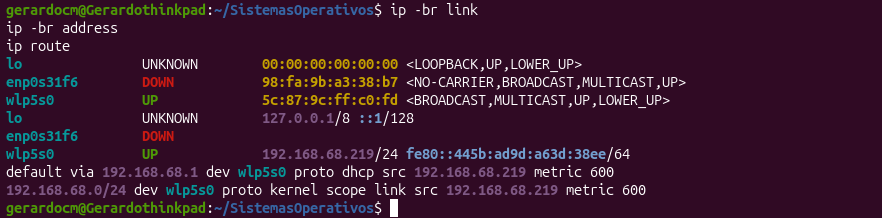
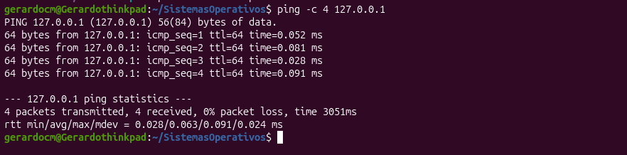
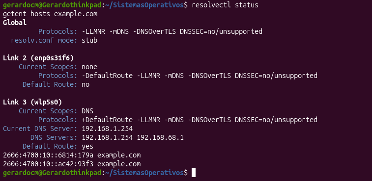
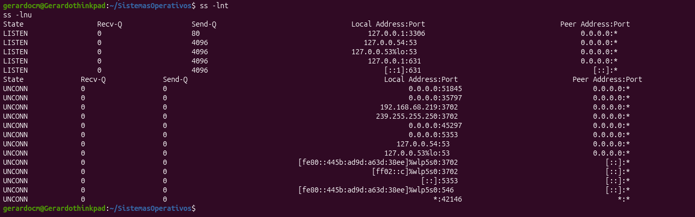
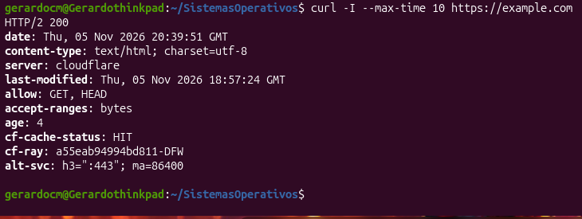

# 🟢 Semana 11 — Diagnóstico de redes desde la terminal

## 👤 Datos del alumno
- **Nombre:** José Gerardo Cabrera Miranda
- **Fecha:** Noviembre de 2026

## 🖥️ Entorno de Trabajo
- **Distribución y versión:** Ubuntu 26.04.1 LTS (Resolute Raccoon)
- **Kernel:** Linux 7.0.0-42-generic (x86_64)
- **Equipo:** Físico (Lenovo ThinkPad L490)[cite: 4]

## 🎯 Objetivo de la práctica
Diagnosticar la conectividad de red en Ubuntu mediante una secuencia ordenada de consultas desde la terminal, inspeccionando interfaces, direcciones IP, rutas, resolución DNS, sockets y respuestas HTTP[cite: 7].

---

## 📋 Inventario y Resultados del Diagnóstico

| Capa / Componente | Comando utilizado | Descripción del resultado obtenido en el equipo |
|---|---|---|
| **Interfaces y Direcciones** | `ip -br link` / `ip -br address` | Se consultaron las interfaces de red activas del equipo y sus respectivas direcciones IP asignadas. |
| **Tabla de Rutas** | `ip route` | Se identificó la puerta de enlace predeterminada y la ruta de salida del tráfico de red. |
| **Conectividad Local** | `ping -c 4 127.0.0.1` | Se comprobó el funcionamiento correcto de la pila de red local mediante la interfaz de loopback. |
| **Resolución DNS** | `resolvectl status` / `getent hosts` | Se verificó el estado de la resolución de nombres de dominio y los servidores DNS configurados. |
| **Sockets y Puertos** | `ss -lnt` / `ss -lnu` | Se listaron los sockets TCP y UDP que se encuentran escuchando conexiones en el sistema. |
| **Respuesta Web (HTTP)** | `curl -I --max-time 10` | Se comprobó la recepción de cabeceras HTTP desde un destino externo autorizado. |

---

## 📸 Registro de Evidencias (Capturas)

Las siguientes capturas se encuentran almacenadas en la carpeta `semana11/evidencias/`:

1. **`01_interfaces_y_rutas.png`**  
   Listado resumido de interfaces y direcciones IP junto con la tabla de rutas del sistema (`ip -br address`, `ip route`).
   
3. **`02_pruebas_conectividad.png`**  
   Ejecución de la prueba de conectividad local con `ping` hacia el loopback (`127.0.0.1`).

5. **`03_resolucion_dns.png`**  
   Consulta del estado de resolución de nombres y servidores DNS (`resolvectl status`, `getent hosts`).
   
7. **`04_sockets_y_puertos.png`**  
   Inspección de los servicios y puertos en escucha mediante `ss -lnt`.
   
9. **`05_prueba_http.png`**  
   Prueba de solicitud de cabeceras web utilizando `curl -I`.
   

---

## 🧠 Preguntas de Análisis y Repaso

1. **¿Qué muestra `ip -br address`?**  
   *Muestra un resumen conciso de las interfaces de red disponibles en el equipo junto con sus direcciones IP asignadas y estado operativo.*

2. **¿Qué diferencia existe entre una interfaz y una dirección IP?**  
   *La interfaz es el componente o puerto lógico/físico mediante el cual el sistema transmite datos, mientras que la dirección IP es la identificación lógica asignada a esa interfaz para ubicarse en la red.*

3. **¿Para qué sirve `ip route`?**  
   *Permite consultar la tabla de rutas del kernel para saber por dónde se enrutan los paquetes hacia diferentes redes, incluyendo la puerta de enlace predeterminada.*

4. **¿Qué es una ruta predeterminada?**  
   *Es la regla de ruta a la que se envían todos los paquetes cuyo destino no coincide con una ruta más específica en la tabla.*

5. **¿Qué comprueba `ping 127.0.0.1`?**  
   *Verifica que la pila de protocolos de red interna del sistema operativo esté funcionando correctamente a nivel local.*

6. **¿Por qué puede no responder un destino a `ping`?**  
   *Porque las políticas de seguridad del dispositivo remoto o de la red bloquean deliberadamente los mensajes ICMP de tipo eco, aunque el equipo esté en línea.*

7. **¿Qué función cumple DNS?**  
   *Traduce nombres de dominio legibles por humanos (como un sitio web) a direcciones IP numéricas comprensibles por las redes de computadoras.*

8. **¿Qué diferencia hay entre `getent hosts` y `dig`?**  
   *`getent hosts` consulta la base de datos general de resolución configurada en el sistema operativo, mientras que `dig` realiza consultas directas y detalladas a los servidores de nombres DNS.*

9. **¿Qué consulta `ss -lnt`?**  
   *Lista de manera rápida todos los sockets TCP que se encuentran activos y en estado de escucha (*listening*) esperando conexiones.*

10. **¿Por qué conviene diagnosticar por etapas?**  
    *Porque permite descartar problemas de manera ordenada (desde la interfaz física hasta la capa de aplicación), evitando suposiciones erróneas o cambios innecesarios de configuración.*

---

## 🏁 Conclusión
El diagnóstico de redes por la terminal demostró la importancia de seguir un método estructurado capa por capa. El uso de comandos como `ip`, `ss`, `getent` y `curl` facilita encontrar el origen real de una falla de conectividad sin alterar configuraciones de forma improvisada.
