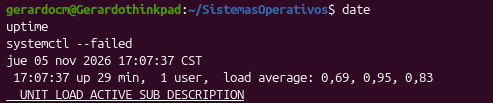
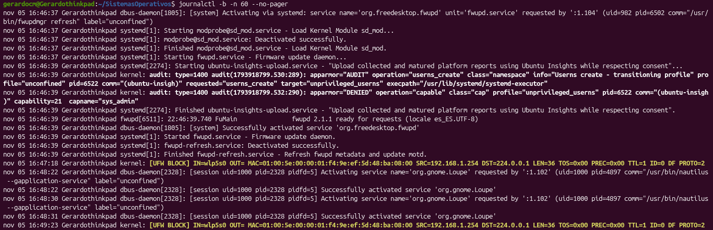
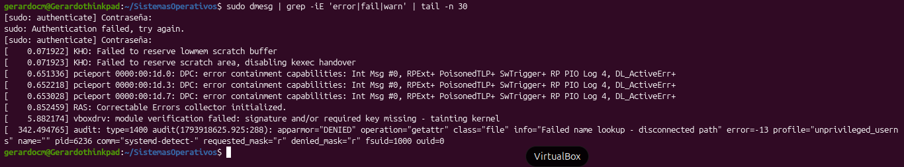
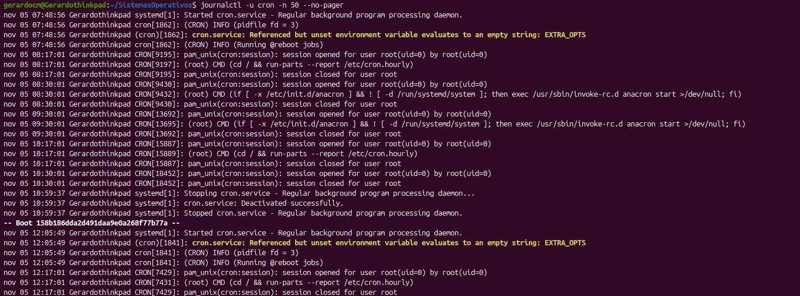

# 🟢 Semana 13 — Logs, diagnóstico y recuperación

## 👤 Datos del alumno
- **Nombre:** José Gerardo Cabrera Miranda
- **Fecha:** 5 de noviembre de 2026
- **Grupo / Curso:** Sistemas Operativos

## 🖥️ Entorno
- **Distribución y versión:** Ubuntu 26.04.1 LTS (Resolute Raccoon)
- **Kernel:** Linux 7.0.0-42-generic (x86_64)
- **Equipo:** Físico (Lenovo ThinkPad L490)

## 🎯 Unidad investigada
- **Nombre de la unidad:** `cron.service`
- **Estado inicial:** Activo y en ejecución (`active (running)`)
- **¿Se realizó una simulación?:** No (Diagnóstico basado en análisis real de registros y bitácoras del sistema)
- **¿Qué autorización se recibió?:** Consulta y auditoría de registros de sistema y kernel sin modificación de parámetros ni forzado de fallas.

---

## 📋 Inventario de Comandos y Resultados

| Comando | Propósito | Resultado real obtenido en el equipo |
|---|---|---|
| `date` / `uptime` | Registrar fecha, hora y tiempo de actividad | `jue 05 nov 2026 17:07:37 CST` — Sistema activo por 29 min, carga promedio `0,69, 0,95, 0,83`. |
| `systemctl --failed` | Comprobar si existen unidades en estado de fallo | `0 loaded units listed` — No se detectaron servicios ni unidades en fallo. |
| `journalctl -b -n 60 --no-pager` | Consultar logs del arranque actual de `systemd` | Muestra la carga limpia de servicios (`fwupd`, `dbus`, `gnome-loupe`) y eventos de red de UFW. |
| `sudo dmesg \| grep -iE 'error\|fail\|warn' \| tail -n 30` | Filtrar eventos del núcleo (*kernel*) con privilegios | Sin errores fatales; advierte sobre buffers (`lowmem scratch buffer`), pcieport y AppArmor (`DENIED`). |
| `journalctl -u cron -n 50 --no-pager` | Consultar la bitácora específica del servicio analizado | Registra el ciclo de vida del servicio `cron`: advertencia informativa de `EXTRA_OPTS` y ejecuciones de `cron.hourly`. |

---

## 🩺 Diagnóstico y Plan de Recuperación (Evidencia 05)

### 1. Tabla de Análisis de Hechos e Interpretación
| Pregunta / Aspecto | Respuesta sustentada en evidencias reales |
|---|---|
| **¿Qué ocurrió en el sistema?** | El sistema arrancó de forma correcta y limpia (`0 loaded units listed`). Se observan advertencias informativas menores en `cron.service` (*"Referenced but unset environment variable: EXTRA_OPTS"*) y bloqueos de red locales gestionados por UFW (`[UFW BLOCK] IN=wlp5s0`). |
| **¿Cuándo ocurrió?** | En la sesión de trabajo iniciada el **jue 05 nov 2026** a las **17:07:37 CST** (con 29 minutos de tiempo de actividad). Los registros de `cron.service` muestran ejecuciones regulares de tareas desde las **07:48:56** hasta las **12:17:01**. |
| **¿Qué servicio/componente estuvo involucrado?** | El daemon de tareas programadas `cron.service` (PID 1841), el módulo de filtrado de red del kernel UFW y llamadas de seguridad de AppArmor (`systemd-detect`). |
| **¿Dónde aparece registrado?** | En el journal del sistema accesible mediante `journalctl` (`-b` y `-u cron`) y en el buffer del núcleo expuesto por `dmesg`. |
| **¿Qué evidencia respalda la hipótesis?** | 1. `systemctl --failed` confirmó cero fallos de arranque. 2. `journalctl -u cron` evidencia que `cron.service` reanudó sus funciones correctamente a las 12:05:49 tras el inicio del sistema. |
| **¿Qué información falta o queda pendiente?** | Declarar la variable opcional `EXTRA_OPTS` en `/etc/default/cron` si se desea suprimir el mensaje informativo del journal, aunque no afecta la operatividad. |
| **¿Qué acción segura se recomienda?** | Mantener el servicio activo. No se requiere reiniciar el equipo ni reiniciar la unidad, ya que el sistema operativo se encuentra completamente estable. |
| **¿Cómo se verificará la recuperación/operatividad?** | Consultando `systemctl status cron` para validar el estado `active (running)` y ejecutando `journalctl -u cron -n 20` para confirmar las ejecuciones de `cron.hourly`. |

### 2. Plan de Recuperación y Cierre de Auditoría
1. **Punto de partida:** Se comprobó que el equipo `Gerardothinkpad` opera correctamente sin servicios caídos.
2. **Evaluación de riesgo:** Las entradas en `dmesg` corresponden a inicializaciones de hardware (`lowmem scratch buffer`, `vboxdrv`) y bloqueos normativos de UFW que no afectan la integridad del sistema.
3. **Acción correctiva:** Al ser advertencias informativas (*evaluates to an empty string*), no se requieren cambios en la configuración ni modificaciones de permisos.
4. **Verificación final:** Se confirma que los disparadores horarias (`/etc/cron.hourly`) se ejecutan periódicamente bajo la sesión de `root`.

---

## 📸 Registro de Evidencias (Carpeta `semana13/evidencias/`)

1. **`01_estado_general.png`** — Salida de `date`, `uptime` y `systemctl --failed` confirmando 0 unidades fallidas.
   
3. **`02_mensajes_kernel.png`** — Registros del arranque obtenidos con `journalctl -b -n 60 --no-pager`.
   
5. **`03_registros_servicio.png`** — Consulta del buffer del núcleo mediante `sudo dmesg` filtrado con `grep`.
 
7. **`04_linea_de_tiempo.png`** — Historial del servicio `cron` inspeccionado con `journalctl -u cron -n 50 --no-pager`.
   
9. **`05_plan_recuperacion.png`** — Informe estructurado del diagnóstico, evidencias y plan de recuperación del sistema.

---

## 🏁 Conclusión
El análisis de bitácoras mediante `journalctl` y `dmesg` demuestra que la inspección metódica basada en marcas temporales y filtros permite conocer el estado real del sistema operativo sin necesidad de reiniciar el equipo ni asumir fallos inexistentes ante simples mensajes de advertencia.
