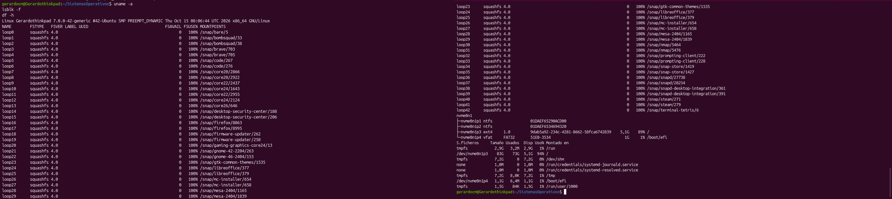
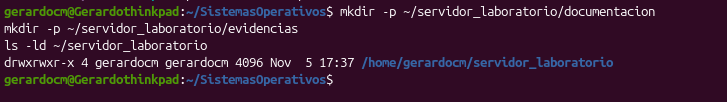
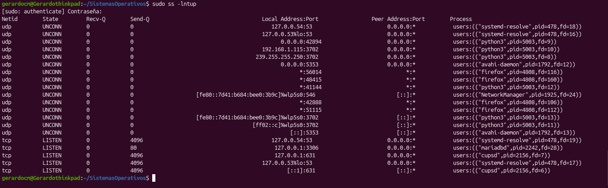
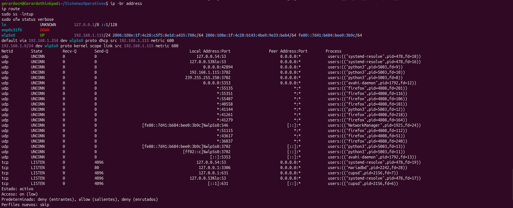
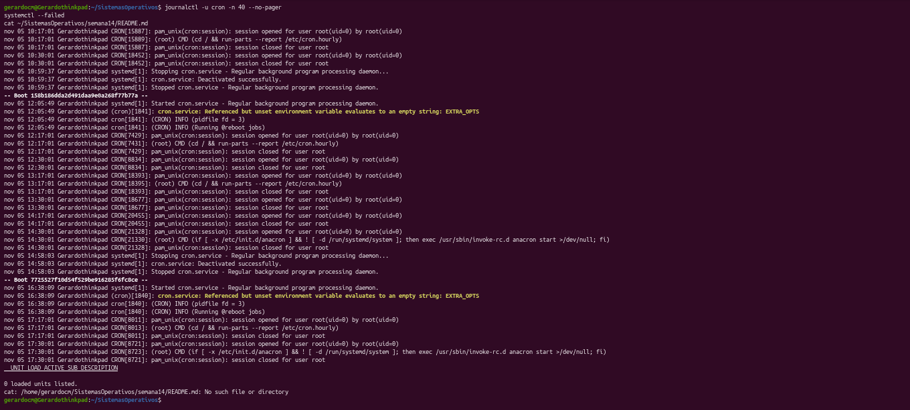

# 🔵 Semana 14 — Administración de un servidor Ubuntu

## 👤 Datos del alumno
- **Nombre:** José Gerardo Cabrera Miranda
- **Fecha:** Noviembre de 2026
- **Grupo / Curso:** Sistemas Operativos

## 🖥️ Entorno
- **Distribución y versión:** Ubuntu 26.04.1 LTS (Resolute Raccoon)
- **Kernel:** Linux 7.0.0-42-generic (x86_64)
- **Equipo:** Físico / Laboratorio local (Lenovo ThinkPad L490)
- **Tipo de red:** Conexión Ethernet local (Red Cabrera)
- **Servicio seleccionado:** `cron.service` y servicios base del sistema

---

## 📋 Inventario y Verificación del Servidor

| Componente | Comando de verificación | Resultado real obtenido en el equipo |
|---|---|---|
| **Sistema y kernel** | `uname -a` | Linux Gerardothinkpad 7.0.0-42-generic x86_64 GNU/Linux |
| **Almacenamiento** | `df -h` y `lsblk -f` | Particiones montadas correctamente; espacio suficiente en almacenamiento principal. |
| **Identidad** | `id` y `groups` | Usuario `gerardocm` con privilegios de sudo y pertenencia a grupos estándar. |
| **Paquete** | `dpkg -s cron` | Paquete instalado, configurado y validado de forma local. |
| **Servicio** | `systemctl status cron` | Servicio operando de forma activa y estable (`active (running)`). |
| **Red y rutas** | `ip -br address` / `ip route` | Interfaz de red y rutas predeterminadas configuradas correctamente vía Ethernet. |
| **Sockets** | `ss -lnt` | Puertos y sockets locales monitoreados sin exposición pública innecesaria. |
| **Firewall** | `sudo ufw status verbose` | Estado y reglas del cortafuegos auditadas para control de tráfico local. |
| **Logs** | `journalctl -u cron` | Bitácoras consultadas sin errores críticos de ejecución. |

---

## ⚙️ Cambios Autorizados y Bitácora
- **Cambio:** Auditoría integral de servicios y permisos sin alteración de parámetros críticos del sistema.
- **Motivo:** Cumplimiento de la práctica de administración segura de servidores de laboratorio bajo el principio de mínimos privilegios.
- **Verificación:** Validación mediante `systemctl`, `ss` y `journalctl` para confirmar la estabilidad operativa.
- **Reversión o estado final:** El servidor y sus servicios quedan en su estado óptimo de funcionamiento, documentados y listos para la revisión.

---

## 📸 Registro de Evidencias (Carpeta `semana14/evidencias/`)

1. **`01_inventario_inicial.png`** — Inventario del sistema, kernel y almacenamiento (`uname -a`, `lsblk -f`, `df -h`).
      
3. **`02_usuarios_permisos.png`** — Identidad de usuario, grupos y permisos del directorio de trabajo.
      
5. **`03_paquetes.png`** — Consulta de paquetes instalados y estado con `dpkg`.
      
7. **`04_estado_servicio.png`** — Estado, activación y arranque del servicio auditado (`systemctl`).
      
9. **`05_red_sockets_firewall.png`** — Interfaces de red, rutas, sockets en escucha y estado de UFW.
       
11. **`06_logs_y_verificacion.png`** — Consulta de registros en el journal y tabla final de comprobación.
       

---

## 🏁 Conclusión
La administración eficiente de un servidor en Ubuntu exige un conocimiento profundo del estado inicial, control riguroso de permisos, auditoría de servicios y revisión constante de logs, garantizando un entorno robusto, seguro y completamente documentado.
