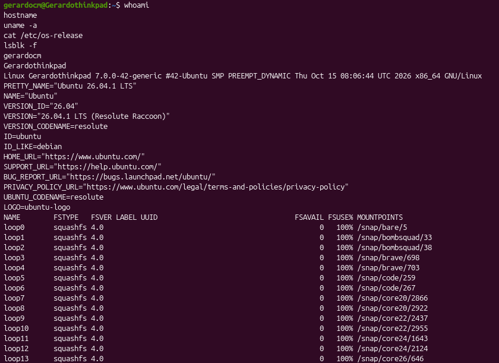
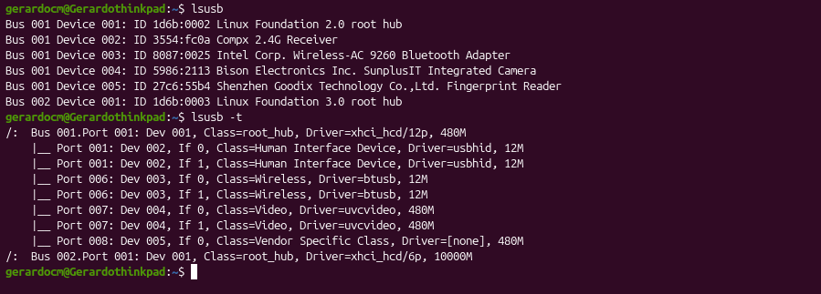
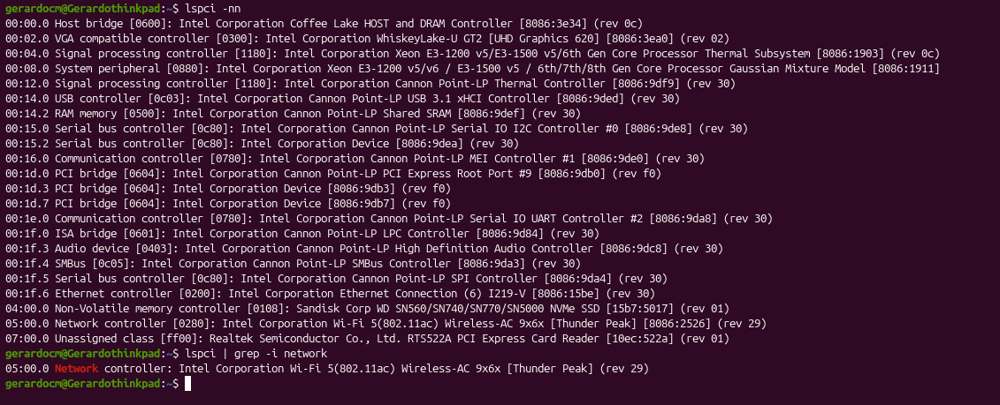
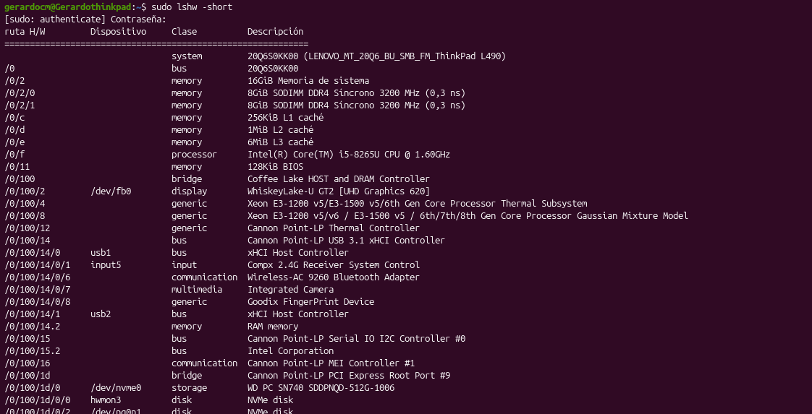
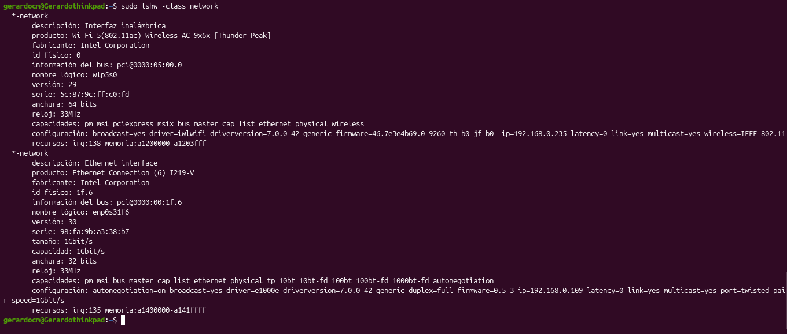
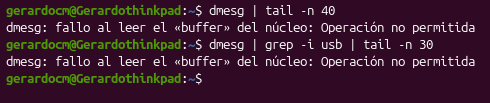

# 🟢 Semana 09 — Entrada/salida y dispositivos en Ubuntu

## 👤 Datos del alumno
- **Nombre:** José Gerardo Cabrera Miranda
- **Fecha:** Noviembre de 2026

## 🖥️ Entorno de Trabajo
- **Distribución y versión:** Ubuntu 26.04.1 LTS (Resolute Raccoon)
- **Kernel:** Linux 7.0.0-42-generic (x86_64)
- **Equipo:** Físico (Lenovo ThinkPad L490)[cite: 4, 8]

## 🎯 Objetivo de la práctica
Identificar los dispositivos de hardware reconocidos por Ubuntu mediante el uso de comandos orientados a la terminal (`lsusb`, `lspci`, `lshw`, `lsblk`) y examinar el comportamiento de los registros e inicialización del kernel[cite: 4].

---

## 📋 Inventario y Resultados del Hardware

| Componente / Categoría | Comando utilizado | Descripción del resultado obtenido en el equipo |
|---|---|---|
| **Almacenamiento y Bloques** | `lsblk -f` | Se listaron las unidades de bloques del sistema, destacando las unidades de bucle (`loop0` a `loop13`) utilizadas por los paquetes Snap. |
| **Periféricos USB** | `lsusb` / `lsusb -t` | Se identificaron controladores xHCI, un receptor inalámbrico 2.4G, adaptador Bluetooth Intel Wireless-AC 9260, cámara integrada Bison y lector de huellas Goodix[cite: 9]. |
| **Buses PCI e Internos** | `lspci -nn` | Se consultaron los componentes conectados al bus PCI, como la tarjeta gráfica Intel UHD Graphics 620, Ethernet Intel I219-V, almacenamiento NVMe y controladoras internas[cite: 8]. |
| **Inventario General** | `sudo lshw -short` | Se obtuvo un desglose completo de los componentes físicos y lógicos de la laptop (16 GiB de RAM, procesador Intel Core i5-8265U)[cite: 4, 8]. |
| **Interfaces de Red** | `sudo lshw -class network` | Se reconocieron de forma específica la interfaz inalámbrica Wi-Fi (`wlp5s0` con driver `iwlwifi`) y la interfaz Ethernet cableada (`enp0s31f6` con driver `e1000e`)[cite: 6]. |

---

## 📸 Registro de Evidencias (Capturas)

Las siguientes capturas se encuentran almacenadas en la carpeta `evidencias/` y respaldan la ejecución de los comandos:

1. **`01_sistema_y_almacenamiento.png`**  
   Verificación de la versión de Ubuntu (`cat /etc/os-release`), arquitectura del kernel (`uname -a`) y unidades de bloques (`lsblk -f`)[cite: 4].
   
   
3. **`02_dispositivos_usb.png`**  
   Listado y topología en árbol de los puertos y dispositivos USB conectados al equipo (`lsusb` y `lsusb -t`)[cite: 4, 9].
   
   
5. **`03_dispositivos_pci.png`**  
   Consulta de componentes internos del bus PCI (`lspci -nn`) y filtrado específico para la red (`lspci | grep -i network`)[cite: 4, 8].
   
   
7. **`04_inventario_hardware.png`**  
   Resumen general del hardware del sistema utilizando `sudo lshw -short`[cite: 4, 8].
   
9. **`05_red_lshw.png`**  
   Detalle de las interfaces de red de la laptop con `sudo lshw -class network`[cite: 4, 6].
   
   
11. **`06_mensajes_kernel.png`**  
   Consulta de registros del kernel mediante `dmesg`, observando las políticas de restricción de permisos del sistema para usuarios estándar

---

## 🧠 Preguntas de Análisis y Repaso

1. **¿Qué diferencia hay entre un dispositivo de entrada y uno de salida?**  
   *Los dispositivos de entrada introducen información y datos a la computadora (como el teclado o el mouse), mientras que los de salida muestran o reproducen la información procesada hacia el usuario (como la pantalla o las bocinas).*

2. **¿Qué función cumple un controlador (*driver*)?**  
   *Actúa como un traductor lógico que permite al sistema operativo comunicarse de manera adecuada con una pieza de hardware específica para aprovechar sus funciones.*

3. **¿Qué consulta `lsusb`?**  
   *Genera un listado de todos los periféricos y componentes conectados a los puertos USB de la computadora[cite: 4].*

4. **¿Qué diferencia hay entre USB y PCI?**  
   *El bus USB se utiliza comúnmente para conectar periféricos externos, mientras que el bus PCI/PCIe corresponde a la conexión de componentes internos fijos en la placa base (como la tarjeta gráfica o el almacenamiento NVMe).*

5. **¿Qué muestra `lspci -nn`?**  
   *Muestra los componentes conectados al bus PCI junto con sus códigos numéricos oficiales de fabricante y dispositivo, permitiendo identificarlos con precisión[cite: 4].*

6. **¿Para qué sirve `lshw`?**  
   *Es una herramienta orientada a recopilar un inventario completo y detallado del hardware físico y lógico del equipo[cite: 4].*

7. **¿Qué información aporta `lsblk -f`?**  
   *Muestra los dispositivos de almacenamiento en bloques (discos y particiones) junto con los sistemas de archivos que emplean, etiquetas y códigos únicos UUID[cite: 4].*

8. **¿Qué es el kernel y qué muestra `dmesg`?**  
   *El kernel es el núcleo del sistema operativo. `dmesg` permite consultar los mensajes registrados en su búfer interno, incluyendo los avisos sobre detección e inicialización de hardware[cite: 4].*

9. **¿Por qué una línea de advertencia en los registros no demuestra automáticamente que un dispositivo esté averiado?**  
   *Porque muchas veces corresponden a avisos meramente informativos del sistema o de compatibilidad de controladores que no comprometen la operación del componente.*

10. **¿Qué diferencia existe entre detectar un dispositivo y poder utilizarlo?**  
    *Que el sistema lo detecte significa que reconoce su presencia física en el puerto; sin embargo, para utilizarlo operativamente, requiere además contar con el controlador (*driver*) adecuado.*

---

## Conclusion
La práctica permitió comprobar que Ubuntu detecta de forma automática y transparente los componentes internos y periféricos de la computadora. El uso coordinado de herramientas como `lsusb`, `lspci` y `lshw` facilita una auditoría y un diagnóstico rápido del hardware sin alterar la configuración del sistema operativo[cite: 4].
